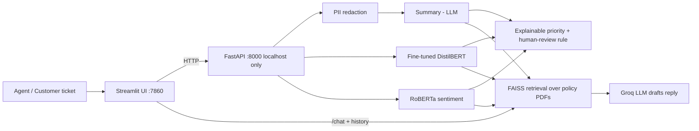

# 🎧 Smart Support Desk Assistant

An AI triage and policy-assistant for customer-support teams (Domain: Customer Service · Category: NLP).

| Sub-task | Model | Where |
|---|---|---|
| 1. Ticket classification (11 categories + OTHER) | **Fine-tuned DistilBERT** (own model) | `training/`, `app/nlp_tasks.py` |
| 2. Sentiment analysis | RoBERTa (pre-trained SLM) | `app/nlp_tasks.py` |
| 3. Summarisation | `gpt-oss-20b` via Groq (LLM) | `app/nlp_tasks.py` |
| 4. RAG policy chatbot with citations | MiniLM + FAISS + LLM | `app/rag.py` |
| 5. Reply drafting using category + summary + sentiment | RAG + LLM | `app/rag.py::draft_reply` |



## What changed vs. version 1 (bug fixes and improvements)
| Area | Fix |
|---|---|
| RAG | Chunk 200→130 words (MiniLM was ignoring the tail); relevance threshold (no LLM call when nothing matches); sources only shown when an answer is given; page numbers; chat memory; persisted FAISS index; empty/corrupt PDF guards; prompt-injection-safe prompts |
| Cohesion | Reply now uses category + summary + sentiment (empathetic tone on angry tickets) |
| Priority | Explainable rules (security, money, urgency, sentiment) with reasons |
| Classifier | Added `OTHER` class so out-of-scope text is not forced into a category; long emails classified from their summary; noisy training data; deduplicated, 70/15/15 split |
| Reliability | Timeouts, retries, graceful degradation if the LLM fails, Pydantic schemas, `/health`, `st.spinner`, results kept in `session_state` |
| Privacy | Emails, phone numbers, card and ID numbers redacted before any text goes to the LLM |
| Ops | Dockerfile, CI, auto-deploy to Hugging Face Spaces, unit tests |

---
## Step-by-step: run, train, deploy (all free)

### Step 0 · Accounts (all free, no card)
GitHub · Hugging Face (huggingface.co) · Groq (console.groq.com → API Keys → create key).

### Step 1 · Put the code on GitHub
```bash
git clone <this folder>  # or unzip the provided zip
cd smart-support-desk
git init && git add . && git commit -m "Smart Support Desk Assistant v2"
git branch -M main
git remote add origin https://github.com/<your-username>/smart-support-desk.git
git push -u origin main
```
(Create the empty repo `smart-support-desk` on github.com first. Keep it **public** or add your evaluator.)

### Step 2 · Fine-tune the classifier on free Colab (about 5–10 min)
1. colab.research.google.com → New notebook → Runtime → Change runtime type → **T4 GPU**.
2. Run:
```python
!git clone https://github.com/<your-username>/smart-support-desk
%cd smart-support-desk
!pip install -q -r training/requirements-train.txt
from huggingface_hub import notebook_login; notebook_login()   # paste a *write* token from hf.co/settings/tokens
!python -m training.train_classifier --out ticket-classifier --push_to_hub <hf-username>/ticket-classifier
!python -m training.evaluate_classifier --model ticket-classifier --baseline
```
3. **Screenshot** the training table and evaluation tables, then download `reports/` (confusion matrix, confidence plot, `metrics.json`) for the report.
4. Look at the "wrong:" lines for the messy set and the threshold table. If a different threshold gives a better trade-off, set `CONFIDENCE_THRESHOLD` (Step 4).

### Step 3 · Create the free Hugging Face Space (hosting)
1. huggingface.co → New → **Space** → name `smart-support-desk` → SDK **Docker** → *Blank* → Hardware **CPU basic (free)** → Create.
2. Space → **Settings → Variables and secrets**:
   * Secret `GROQ_API_KEY` = your Groq key
   * Variable `CLASSIFIER_MODEL` = `<hf-username>/ticket-classifier`
3. Deploy (choose one):
   * **Automatic (recommended, "do it in GitHub")**: GitHub repo → Settings → Secrets and variables → Actions → add secret `HF_TOKEN` (HF write token) and variables `HF_USERNAME`, `HF_SPACE` (=`smart-support-desk`). Every push to `main` now redeploys.
   * **Manual**: `git remote add space https://huggingface.co/spaces/<hf-username>/smart-support-desk && git push space main`
4. The first build takes about 8–12 minutes. Your live URL: `https://<hf-username>-smart-support-desk.hf.space`.

### Step 4 · Verify
* Sidebar shows **API 🟢 ready** and **LLM key 🟢 set**.
* Try the five built-in sample tickets, then the chatbot with an out-of-scope question ("who won the cricket world cup?") → it must answer *"I could not find this…"* with no sources.
* Free Spaces sleep after about 48 h idle; open the URL a few minutes before the demo or evaluation.

### Run locally instead
```bash
python -m venv .venv && source .venv/bin/activate        # Windows: .venv\Scripts\activate
pip install torch --index-url https://download.pytorch.org/whl/cpu
pip install -r requirements.txt
cp .env.example .env      # add GROQ_API_KEY; set CLASSIFIER_MODEL to your HF repo or ./ticket-classifier
uvicorn app.api:app --port 8000 &                         # API docs: http://localhost:8000/docs
streamlit run app/ui.py                                   # UI: http://localhost:8501
```

### Tests and evaluation
```bash
python -m unittest discover -s tests -v    # 19 tests, no models/keys needed
python -m eval.rag_eval                    # 29 questions: retrieval hit@4 + out-of-scope rejection
python -m eval.rag_eval --with-llm         # + answer accuracy (needs GROQ_API_KEY)
```

### Other free options (and why not)
| Option | Verdict |
|---|---|
| **Hugging Face Spaces (Docker)** | ✅ 16 GB RAM, free, public URL. Best fit for torch + 3 models. |
| Streamlit Community Cloud | ⚠️ ~1 GB RAM: torch + models usually crash it. |
| Render / Railway free tiers | ⚠️ 512 MB RAM or trial credits only. |
| Google Colab + ngrok | Fallback for a live demo only (not persistent). |

### Troubleshooting
* *Push to HF rejected: "binary files"* → `git lfs install && git lfs track "*.pdf" && git add .gitattributes && git commit -am lfs`, re-add the PDFs, push again.
* *`LLM request failed`* → check `GROQ_API_KEY`, and that `LLM_MODEL` is still listed at console.groq.com/docs/models.
* *Classifier shows `LABEL_0`* → you used the old model; retrain with Step 2 (labels are saved in the config).
* *Rate limited (HTTP 429)* → Groq free tier has per-minute limits; wait a minute.

## Repository map
```
app/        api.py  ui.py  rag.py  nlp_tasks.py  priority.py  privacy.py  llm.py  config.py
training/   data.py  train_classifier.py  evaluate_classifier.py  messy_test_set.json
eval/       rag_eval.py + question sets      tests/  unit tests      docs/  policy PDFs (fictional ShopEase)
report/     report template + submission checklist + video script
```
> ShopEase is fictional. The five sample policies (refund & returns, shipping & delivery, order cancellation, payment/billing/invoice, account/complaints/escalation) are generated from `scripts/policy_content.py` by `scripts/make_sample_pdfs.py`. Replace them with your workplace documents to personalise (index rebuilds automatically).
